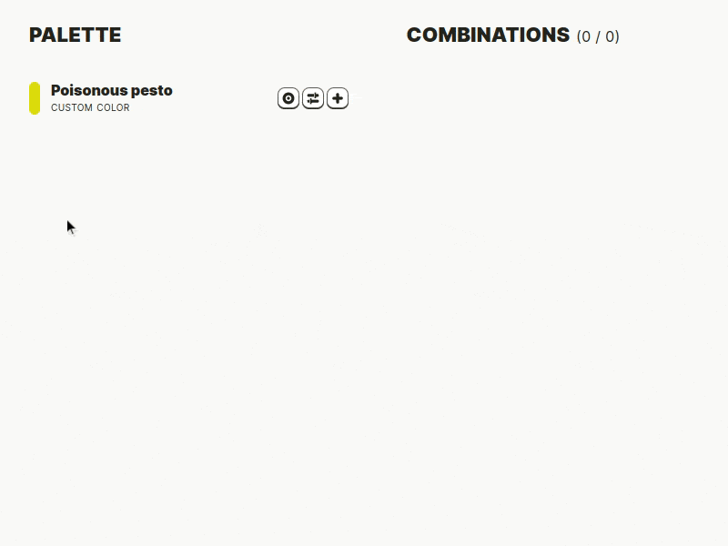

# Schemist

Build cohesive and accessible color schemes :
[schemist.fglt.fr](http://schemist.fglt.fr)



Note that Schemist is still in its early days, so things might be
subject to change. Feel free to report bugs or suggest
improvements!

## Concept

Schemist builds on color theory to let you create cohesive color
schemes with ease. Colors are defined as a tree, where each one
depends on its parent. This allows for building a whole palette
based on one color, and get a whole new palette by just changing
this base color.

Schemist provides modifiers, for example to lighten or darken a
color, shift its hue, find common harmonies (complementary,
triad, tetrad, ...), find contrasting colors, and more.

To ease the process, a set of presets is included, allowing you
to generate whole palettes from a base color in one click.

While building your palette, you'll be able to review the
contrast of each color combination to ensure that they are
accessible to everyone.

The whole thing is reactive, so play around!

## How it works

Dear color theory experts, please don't get mad.

Schemist uses its own "color space", or more prcisely mixes and
matches two of them. It rotates hues with Oklch, which has more
uniform hues than, say, HSL. However, instead of using Oklch's
chroma and lightness, it uses saturation and lightness from
Okhsl, as it is a more human-friendly way of interacting with
color.

Yes, it is probably wrong on many levels, but to me it yielded
the best results overall, in terms of ergonomics and outputs.

## Command-line interface

Schemist also runs from the command line, so that agents (or
scripts) can generate and check color schemes: describe a palette
as a JSON tree, read its colors and contrasts, export it, and
hand back a permalink. It runs on the same code as the app, so
results match.

A good loop for an agent: read `types` and `presets`, write a
tree, then check it before exporting. `eval` the pairs the design
uses (`--pair`) with both `--contrast wcag2` and
`--contrast apca`, each with
`--blindness protanomaly,deuteranomaly,tritanomaly`, and read
`minLevel`, the worst case. Aim for 4.5 (AA) and Lc 60 for body
text, and 3 for large text and non-text UI such as input borders
and focus rings. Contrast doesn't tell whether two colors look
different: for categorical colors (chart series, tags, map
regions), check every pair among them with
`eval --difference --blindness …` and aim for a
`difference.minLevel` of at least 10, more for small marks like
scatter plot points. What you usually tune is the `amount` of
Lightness (`l`) and Saturation (`s`) nodes: adjust, re-run, and
repeat until every pair passes. Then `export` it and give the
permalinks back so the palettes can be opened and tweaked in the
app. See [SPEC.md](SPEC.md) (section 14) for details.

```sh
npm ci
npm run cli:build
npm run cli -- <command>
```

Commands (JSON on stdout, errors on stderr with a non-zero exit
code):

- `types`: the node types and their params.
- `presets`: the presets, which are node types of their own
  (`{"type": "lsc", "args": {"steps": 5}}`), with the nodes they
  generate.
- `eval <tree.json|->`: colors, contrast combinations and a
  permalink.
- `export <tree.json|-> --format css|sass|tokens`: the same text
  as the app's export. Token names with `/` or `.` nest in the
  tokens export (`button/primary/bg` gives `button.primary.bg`
  groups); conflicting names make it fail, so rename them or give
  them distinct tokens.

A tree is nodes with a `type`, optional `token` (the name, where
`$` stands for the parent's name), `args`, `children` and
`isHidden`. Each node derives its color from its parent, like in
the app. Get the available types and params from `types`, and
ideas from `presets`. Presets can't have children. Color args are
CSS color strings, range args are integers within their bounds.
Invalid trees are rejected with the path of the problem, e.g.
`root.children[2].args.amount`.

```json
{
	"type": "clr",
	"token": "Brand",
	"args": {"color": "#3b82f6"},
	"children": [
		{"type": "ctr", "token": "$ text", "args": {"amount": 90}},
		{"type": "l", "token": "$ light", "args": {"amount": 90}},
		{"type": "cmp", "token": "Accent"}
	]
}
```

```sh
$ npm run cli -- eval palette.json --contrast apca \
    --blindness protanomaly,deuteranomaly --pair 'Brand light/Brand text'
{
  "colors": [
    {"name": "Brand", "hex": "#3b82f6"},
    {"name": "Brand text", "hex": "#000921"},
    {"name": "Brand light", "hex": "#d3e4fe"},
    {"name": "Accent", "hex": "#af7d0d"}
  ],
  "combinations": [
    {
      "bg": "Brand text",
      "fg": "Brand light",
      "level": 89.21,
      "grade": "5",
      "minLevel": 88.27,
      "minGrade": "5",
      "simulated": [
        {"type": "protanomaly", "level": 90.63, "grade": "5"},
        {"type": "deuteranomaly", "level": 88.27, "grade": "5"}
      ]
    }
  ],
  "permalink": "https://schemist.fglt.fr?preset=1@3@4526x5a,..."
}

$ npm run cli -- export palette.json --format css --prefix color
/* @see https://schemist.fglt.fr?preset=1@3@4526x5a,... */
--color-brand: #3b82f6;
--color-brand-text: #000921;
--color-brand-light: #d3e4fe;
--color-accent: #af7d0d;
```

`eval` takes `--contrast wcag2|apca`,
`--blindness protanomaly,deuteranomaly,tritanomaly` (adds
`minLevel` and `minGrade`, the worst case with the simulations),
`--min <level>` (hides combinations whose worst level is below)
and `--pair 'fg/bg'`, repeatable, to get only the pairs you care
about, in that order (`\/` stands for a `/` in a name).
`--difference` adds the CIEDE2000 color difference of each pair
(and of its simulations). Levels are truncated to 2 decimals.
`export` takes `--color-format`, `--casing`, `--prefix` and
`--precision`. Both take `--origin` for the permalink.

Changing the CLI, its error messages or this section? Agents read
them, so [evals/](evals/README.md) runs agents on real prompts
and grades the result (it costs a few dollars).

## Kudos

Schemist is build upon these fabulous projects and resources:

- [SvelteKit](https://kit.svelte.dev/)
- [Culori](https://github.com/Evercoder/culori) for the core
  color mechanics
- [color-name-list](https://github.com/meodai/color-names) to
  name colors
- [nearest-color](https://github.com/dtao/nearest-color) to find
  matching color names
- [APCA](https://github.com/Myndex/apca-w3) to calculate contrast
  ratios
- [Inter](https://rsms.me/inter/) for the main font
- [Source code pro](https://fonts.adobe.com/fonts/source-code-pro)
  for monospace texts
- [Font Squirrel generator](https://www.fontsquirrel.com/tools/webfont-generator)
  to subset Source code pro

## Resources

- [Making a useful LCh color palette](https://ninedegreesbelow.com/photography/gimp-srgb-lch-color-palettes.html#saturation)
- [Using LCh to pick complementary colors and for making hue-based color harmonies](https://ninedegreesbelow.com/photography/lch-complements-and-color-harmonies.html)
- [How to Convert Temperature (K) to RGB: Algorithm and Sample Code](https://tannerhelland.com/2012/09/18/convert-temperature-rgb-algorithm-code.html)
